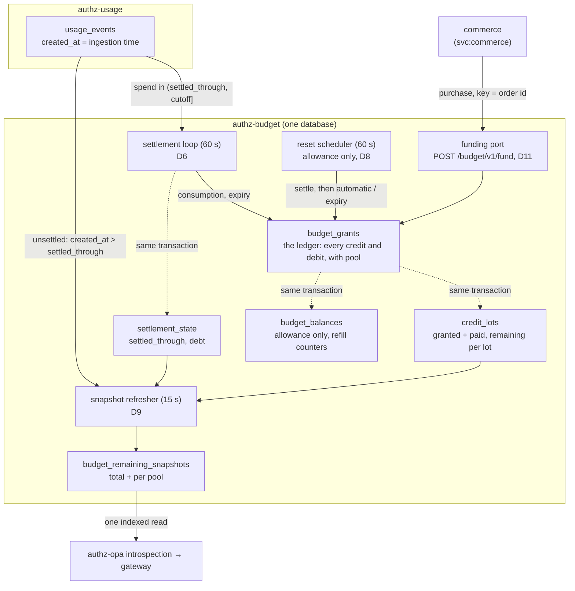

# ADR-0035: Credit lives in three pools; paid and granted credit are lots, and spend is settled into the ledger

- Status: **Withdrawn** (2026-10-23) — reverted; see the withdrawal note below.
- Date: 2026-10-21
- Decision owners: @Koufan-De-King
- Story: _to be filed_ — source of truth: *Lightbridge commercial architecture* (2026-10-07),
  sections "Credits: three pools in one ledger", "Promotions and bookkeeping" and "Top-up with
  mobile money"
- Builds on: [ADR-0007](0007-refill-decisions-rule-data-then-opa-wasm.md) (facts are gathered by
  the host), [ADR-0009](0009-budget-grants-are-an-immutable-ledger.md) (append-only, corrections
  are new rows), [ADR-0030](0030-client-credentials-is-a-first-class-authz-idp-grant.md)
  (`client_credentials` + `private_key_jwt` service tokens)
- Amends:
  - [ADR-0008](0008-refills-are-discrete-budget-tiers.md) — "the period is a calendar month" now
    holds for the **allowance** pool only (D2).
  - [ADR-0009](0009-budget-grants-are-an-immutable-ledger.md) — new sources, a pool on every row,
    and a sign rule that admits debits other than `correction` (D1, D4).
  - [ADR-0032](0032-budget-reset-schedules.md) D2 — a reset clamps the **allowance** pool only, and
    reads a settled balance instead of `ledger − spend` (D8).
  - [ADR-0034](0034-dynamic-budget-limiter.md) §15 — the snapshot's ceiling becomes the sum of the
    pools, and its spend becomes debt plus the unsettled tail (D9). The gateway contract and the
    introspection fields do not change.

> **Withdrawal note (2026-10-23).** The code this ADR introduced is reverted. Purchased lots,
> promotions and a funding port shaped for one merchant are the
> ledger of the deployment that sells credit, not the open core's: that deployment keeps those
> pools itself and reads this service through its public ports. ADR-0008, ADR-0009, ADR-0032 and
> ADR-0034 are therefore back in force as written, without the amendments listed above.
>
> Two things stay. The migration `20261021000001_credit_pools_lots_settlement.sql` remains applied
> and frozen: the columns and tables it added are dead from the revert, and a contract migration
> drops them one release later (ADR-0031). The usage spend query's ingestion-time window
> (`ingested_after`/`ingested_until`) and its index stay too, because any settlement-style reader
> needs them and nothing in them is specific to this ADR.
>
> Settlement ran in production before the revert, so its allowance `consumption` rows, and the
> `budget_balances` debits booked with them, are permanent (ADR-0009). The reverted reads treat
> them as spend, never credit: the ceiling (`/budget/v1/remaining`, the snapshot refresher, the reset
> scheduler, refill facts) skips both settlement sources, and the balance RPCs add them back onto the
> projection, as #776 did. `20261023000001` refuses to migrate only a database holding granted or
> paid credit, which no period-scoped read can see.
>
> The body below is kept unedited, as the record of what was decided and built.

## Context

We are going to sell credit. A closed commerce service (a vpay merchant) will take mobile-money
payments and must be able to book purchased credit into this ledger. Three facts about today's
ledger make that impossible without a change.

**1. Every credit is one month long.** `budget_grants.period` is `NOT NULL` and every balance read
filters `period = <current month>` (`EFFECTIVE_BALANCE_SQL`, `repo.rs`). A grant does not survive the
1st of the month even if no reset schedule exists. Purchased credit has to carry over.

**2. A reset claws back everything.** ADR-0032 D2 computes
`delta = target − (effective_budget − spend_to_date)` over **all** of the account's grants and books
a negative delta as a `correction`. Production runs a global $8 weekly reset. An account holding an
$8 allowance, a $5 promotion and a $20 purchase, having spent $10, is booked a **−$15 correction**
next Monday. Bought credit would be destroyed weekly.

**3. Spend is not in the ledger.** No `source` records consumption. The balance is
`SUM(grants this month) − SUM(usage_events.total_cost this month)`, with the second term read live
from `authz-usage` (`spend.rs`). That works only because both sums are scoped to one month. Once
credit spans months, the same formula needs all spend ever, and it still cannot say *which* credit a
request consumed — which expiry, refunds and revenue reporting all need.

`budget_grants.source` cannot carry any of this: it changes nothing about how a row behaves. It
feeds only the audit breakdown in `budget_balances`. `promotion` and `refund` are allowed values
that no production code writes.

## Decision

### D1 — Every ledger row belongs to one of three pools

`budget_grants` gains `pool TEXT NOT NULL`, one of `allowance`, `granted`, `paid`. Every existing row
is backfilled to `allowance`: none was ever paid, and every one of them behaved as allowance (month
scoped, reset-exposed).

| Pool | Filled by | Expires | Touched by resets | Means, for the books |
|---|---|---|---|---|
| `allowance` | reset schedules, the starting grant, refills | at the end of its period | yes | free-tier cost |
| `granted` | promotions, referrals, goodwill, admin compensation | per lot (`expires_at`) | never | promotion / support spend |
| `paid` | purchases through the funding port (D11) | never, until counsel decides otherwise | never | deferred revenue until consumed |

**The pool is derived from the caller and the source, never from a request body.** A CHECK pins
which pools each source may write:

| Source | Sign | Pool(s) | Written by |
|---|---|---|---|
| `base`, `self_service`, `automatic`, `manual_approval`, `migration`, `refund` | + | `allowance` | existing paths, unchanged |
| `admin` | + | `allowance` or `granted` | `grantBudget`, which gains a `pool` input restricted to these two |
| `promotion`, `referral` | + | `granted` | funding port, once programs exist (see *Not decided here*) |
| `purchase` | + | `paid` | funding port |
| `purchase_reversal` | − | `paid` | funding port |
| `consumption`, `expiry` | − | any | settlement (D6), reset (D8) |
| `correction` | ≠ 0 in `allowance`; − in `granted`/`paid` | any | operators (ADR-0009 compensation) |

`admin` is the only source with a choice, because the PDF's caller table gives a human admin both:
top up someone's allowance, or give them credit that survives resets.

### D2 — Only the allowance pool has a period

`period` becomes nullable, with `CHECK ((pool = 'allowance') = (period IS NOT NULL))`. Granted and
paid rows carry no period, so no month boundary can remove them. The `YYYY-MM` format CHECK stays
for the rows that have one.

This is the half of carry-over that has nothing to do with resets. Removing every reset schedule
today would still delete an admin grant on the 1st, because the balance query filters by period.

### D3 — Allowance stays period-summed; granted and paid credit are tracked per lot

Two different accounting shapes, on purpose:

- **Allowance** keeps today's shape exactly: its balance is the sum of the account's allowance rows
  for the current period, credits and debits alike. Allowance rows never reference a lot.
- **Granted and paid** are **lot-tracked**. The invariant, enforced by CHECKs and by the write path:
  - every **positive** granted/paid row **opens a lot**;
  - every **negative** granted/paid row **names exactly one lot** (`lot_id → budget_grants.id`), and
    that lot is in the same pool and the same budget account.

Lots exist where something needs to know what is left of *one particular* credit:

- an `expiry` must remove exactly the unspent part of one promotion, not the whole granted pool;
- a `purchase_reversal` is capped at the unspent part of *that* purchase;
- revenue is valued at the price each lot was bought at (commerce multiplies; money never enters
  this service).

Allowance needs none of the three — a whole period expires at once, it is never refunded, it earns
no revenue — so it does not pay for lots. This also leaves every historical row valid as it is:
history is all allowance, and allowance rows never had a lot.

### D4 — New sources, and a sign rule keyed on what a row does

`budget_grants_source_chk` adds `purchase`, `purchase_reversal`, `referral`, `consumption`,
`expiry`. `budget_grants_amount_sign_chk` becomes:

- credit sources (`base`, `self_service`, `admin`, `automatic`, `manual_approval`, `refund`,
  `promotion`, `migration`, `purchase`, `referral`) — `amount_micros > 0`;
- debit sources (`purchase_reversal`, `consumption`, `expiry`) — `amount_micros < 0`;
- `correction` — `≠ 0` in `allowance`, `< 0` in `granted`/`paid` (a positive correction there would
  open an anonymous lot; credit a pool through a real source instead).

`budget_grants` keeps its name. It is now the ledger of every credit movement, debits included —
renaming a table every runbook queries buys nothing.

Two columns are added:

- `lot_id TEXT NULL REFERENCES budget_grants(id)` — required on negative granted/paid rows, `NULL`
  everywhere else.
- `external_ref TEXT NULL` — the opaque reference of whatever caused the row (for a purchase, the
  vpay payment-intent id). Stored, never branched on.

### D5 — `credit_lots` is a projection of the ledger

```sql
credit_lots (
  lot_id            TEXT PRIMARY KEY REFERENCES budget_grants(id) ON DELETE CASCADE,
  budget_account_id TEXT NOT NULL REFERENCES accounts(id) ON DELETE CASCADE,
  pool              TEXT NOT NULL CHECK (pool IN ('granted', 'paid')),
  amount_micros     BIGINT NOT NULL CHECK (amount_micros > 0),
  remaining_micros  BIGINT NOT NULL CHECK (remaining_micros >= 0),
  expires_at        TIMESTAMPTZ NULL,
  opened_at         TIMESTAMPTZ NOT NULL,
  closed_at         TIMESTAMPTZ NULL     -- set when remaining reaches 0
)
```

`remaining_micros = amount + Σ(negative rows whose lot_id = this lot)`. It is written **in the same
transaction** as the ledger row that changes it, under a row lock on the lot, exactly as
`budget_balances` is today. It can be dropped and rebuilt by replaying `budget_grants`, and a
rebuild must match it — the same audit property ADR-0009 gives `budget_balances`.

`remaining_micros >= 0` is a CHECK, not a convention: no debit may overdraw a lot. Spend that finds
no credit left is **debt** (D7), never a negative lot.

### D6 — Settlement books spend into the ledger, up to a watermark

A new background loop, **settlement**, runs in the budget process next to the reset scheduler and
the snapshot refresher (`server_budget.rs`), every 60 s, over the same recently-active account set
the snapshot refresher uses. Per account, in **one transaction**:

1. Read `settlement_state.settled_through` (D7). An account with no row starts at the beginning of
   the current allowance period — see *Rollout* for why that is exactly today's number.
2. `cutoff = now() − settle_lag` (default **120 s**).
3. Ask `authz-usage` for the account's spend in the window `(settled_through, cutoff]`, by
   **ingestion time** (below).
4. Pay outstanding **debt** first, then the window's spend, in **spending order**:
   1. allowance — up to the current period's allowance balance, never below zero;
   2. granted lots — soonest `expires_at` first, then oldest `opened_at`;
   3. paid lots — oldest `opened_at` first;
   4. whatever is left becomes debt.
   Each draw is one `consumption` row (allowance rows carry the current `period`; granted/paid rows
   name their `lot_id`), and each touched lot is decremented.
5. Book an `expiry` row for the remaining balance of every granted lot whose `expires_at` has
   passed (after step 4, so spend that happened before expiry was allowed to use the lot).
6. Advance `settled_through` to `cutoff`.

Every settlement row carries
`trigger_key = settle:<budget_account_id>:<settled_through>:<cutoff>:<draw index>`, so a replayed
window collides on `budget_grants_trigger_key_uidx` and books nothing twice. If the usage service
does not answer, **nothing is written and the watermark does not move** — the same fail-closed rule
as ADR-0032 D5, for the same reason: unknown spend is never zero spend.

**The watermark is on `usage_events.created_at`, not `observed_at`.** `created_at` is the row's
ingestion time (the production insert never sets it, so it is always the database's `NOW()`);
`observed_at` is when the gateway saw the request. Usage arrives late (ADR-0034's ingest lag). A
watermark on `observed_at` would silently skip every event that lands with a timestamp older than
`settled_through` — spend that is then never charged. Two consequences:

- `NOW()` is the **transaction start**, not commit time, so a batch committing a few seconds after
  it started carries timestamps already behind a just-advanced watermark. `settle_lag` exists to
  outlast any ingest transaction.
- `authz-usage` gains an index on `(account_id, created_at)` and a window query keyed on
  `created_at`, also bounded below on `observed_at ≥ settled_through − max_lateness` so a
  partitioned table can skip old chunks. `authz-usage` owns `usage_events`, so this is a new
  endpoint there, not a query from the budget side (ADR-0028 D14).

`observed_at` keeps its own job: it is the month a spend *belongs to*, for reporting.

### D7 — Debt is spend that found no credit, and renewal forgives it

```sql
settlement_state (
  budget_account_id TEXT PRIMARY KEY REFERENCES accounts(id) ON DELETE CASCADE,
  settled_through   TIMESTAMPTZ NOT NULL,
  debt_micros       BIGINT NOT NULL DEFAULT 0 CHECK (debt_micros >= 0),
  updated_at        TIMESTAMPTZ NOT NULL DEFAULT now()
)
```

The gateway lags the ledger (Authorino's introspection cache, the snapshot interval, ingest lag), so
an account can spend past zero. That overdraft is recorded as `debt_micros`, and the next settlement
pays it **before** any new spend — so a top-up repays the debt first.

Today an overdraft is forgiven: a reset clamps remaining back to its target, and a new month
restarts spend at zero. To keep that behaviour, **debt is set to zero whenever the allowance is
renewed** — a reset window firing for the account (D8), or the allowance period rolling over. A
configurable per-plan overdraft floor is deferred (*Not decided here*).

Forgiven debt is not a ledger row, because there is no lot to attribute it to. The future monthly
roll-forward must report it as a write-off; until then it is visible in logs and in the snapshot.

### D8 — A reset clamps the allowance pool only, and settles first

ADR-0032 D2 becomes:

1. Settle the account (D6). If settlement cannot run, defer the account exactly as ADR-0032 D5
   defers on unknown spend.
2. `allowance_remaining = SUM(allowance rows for the current period)` — which now includes the
   settled `consumption` rows, so no spend is subtracted on top.
3. `delta = target − allowance_remaining`:
   - `delta > 0` — one `automatic` row, pool `allowance`, as today;
   - `delta < 0` — one **`expiry`** row, pool `allowance` (it was a `correction`): unused allowance
     expiring at a reset is what this row means, and the books report it as such;
   - `delta = 0` — nothing.
4. Clear the account's debt (D7).

Granted and paid lots are never read by a reset. The Monday example from *Context* becomes: the $10
spend settles as allowance $8 → $0 and promotion $5 → $3; the reset sees $0 of allowance and books
+$8 `automatic`; the promotion and the purchase are untouched.

`top_up` mode is unchanged (unconditional `+amount`, pool `allowance`).

### D9 — The snapshot holds one number per pool; introspection still makes one read

`budget_remaining_snapshots` stays the only thing the request path reads (ADR-0034 §15's single
indexed read). It gains `allowance_remaining_micros`, `granted_remaining_micros`,
`paid_remaining_micros` and `debt_micros`, and the existing columns are redefined:

```text
settled   = allowance_sum(period) + Σ granted lots (unexpired) + Σ paid lots
unsettled = spend with created_at > settled_through   (authz-usage)

ceiling_micros   = settled
spent_micros     = debt + unsettled
remaining_micros = ceiling − spent                    (formula unchanged)
```

- The refresher reads the allowance sum, the lots and `settlement_state` in **one `REPEATABLE READ`
  transaction**. Reading the lots just before a settlement commits and the watermark just after
  would count the settled window in neither place; the reverse would count it twice. Settlement
  writes lots and watermark atomically, so one consistent read is always correct.
- The per-pool columns are **estimates** between settlements: the unsettled tail is applied to them
  in spending order at refresh time. The total is exact.
- The grant write path's `apply_grant_delta_tx` moves the matching per-pool column and the total in
  the same transaction, for every pool. Its "no-op when the periods differ" guard applies to
  allowance rows only; a purchase is visible on the very next request regardless of period.
- `period` on the snapshot keeps meaning "the allowance period these numbers describe".

The gateway still reads `remaining_micros` and `next_reset_at`; ADR-0034's contract, the Lua limiter
and the 402 body are unchanged. Exposing which pool ran out (so the console can say "top up" versus
"your free credit resets on …") is a separate change.

### D10 — `budget_balances` keeps its job, for the allowance pool only

`budget_balances` is keyed `(account, period)`, which only the allowance pool has. It keeps
materializing allowance rows exactly as today: the source buckets and the refill counters
(`self_service_grant_count`, `automatic_grant_count`) are unchanged, and the refill policy engine
(ADR-0007/0015) keeps reading them. Allowance `consumption` and `expiry` rows land in
`effective_budget_micros` only, the way a `correction` does today, so that column becomes the
**settled allowance balance**. Granted and paid rows never touch the table.

`BudgetRepo::effective_balance` today feeds four callers (refill, reset, the remaining service, the
snapshot refresher), each of which then subtracts a monthly spend. Each moves to an explicit read —
the settled allowance balance for refill and reset, D9's formula for the snapshot and the remaining
service. Leaving any caller on "ledger minus monthly spend" would subtract spend that settlement has
already booked.

### D11 — The funding port: one idempotent endpoint for machine callers

`POST /budget/v1/fund`, mounted on the **budget-internal listener** (the ADR-0034 listener), on its
own route and its own authentication:

- **Authentication.** A bearer access token minted by authz-idp through `client_credentials` +
  `private_key_jwt` (ADR-0030), verified against `oauth2.jwks_url`. Its `aud` must contain the
  configured budget-internal audience, and its `sub` must appear in
  `server.budget_internal.funding_principals`, a map of principal → sources it may write:

  ```yaml
  funding_principals:
    "svc:commerce": [purchase, purchase_reversal]
  ```

  The listener's shared secret is **not** accepted here. That secret is Authorino's credential for
  balance reads; it identifies no principal, so it cannot scope which sources a caller may write.
  Service tokens hold no permissions today (ADR-0030) — this map is the whole grant.
- **Request.** `budget_account_id`, `source`, `amount_micros`, `idempotency_key` (required — for a
  purchase, the order id), `external_ref` (required for `purchase`), and for a reversal the
  `idempotency_key` of the purchase it reverses. The pool is derived from the source (D1); a body
  never names one.
- **Behaviour.** A `purchase` books one `paid` row and opens its lot, in one transaction with the
  snapshot delta (D9). A replayed `idempotency_key` returns the original row, as
  `BudgetRepo::grant` already does (`ON CONFLICT … DO NOTHING`). A `purchase_reversal` books a
  negative row against that purchase's lot, **capped at the lot's remaining balance** — a larger
  amount is a `409`, because credit already spent cannot be refunded as credit. An account id that
  matches no `accounts` row is a `404` (the ADR-0034 §3.3 convention).
- **No money.** Amounts are integer micro-USD. Currency, prices, the XAF-to-credit rate and payment
  state live in commerce; this service stores `external_ref` and never reads it.

Commerce authorizes the *buyer* (owner or billing role on the account) itself, with the buyer's own
token, before it calls this endpoint. This endpoint authorizes the *caller* only.

## The model, as a diagram



## Rollout

The migration is additive and every existing row keeps its meaning: backfill `pool = 'allowance'`,
leave `period` set, leave `lot_id` and `external_ref` `NULL`. No historical row violates D2–D4.

**For an account with no granted or paid credit, the new balance equals today's.** Before its first
settlement, `settled_through` is the start of the current period, so D9 reads
`allowance_sum(period) − spend since period start` — today's `SUM(grants) − spend this month`. After
settlement, spend moves from the second term into the first and the difference stays the same. The
only divergence is at the edge: an event observed in one month and ingested in the next is counted in
the month it was *ingested*. That is pinned by a test rather than argued.

Order of work:

1. One migration: the `budget_grants` columns and CHECKs, `credit_lots`, `settlement_state`, the
   snapshot columns; and in `migrations-usage`, the `(account_id, created_at)` index.
2. The `authz-usage` window endpoint.
3. Settlement, the reset change (D8) and the refresher change (D9), behind one config switch that
   defaults off, so the code can ship before it is enabled.
4. The funding port (D11), with `funding_principals` empty by default — nothing can fund until a
   principal is configured.

## Consequences

- Purchased credit survives resets and month boundaries, and every unit of it can be traced from its
  purchase to its consumption, expiry or reversal.
- Spend is recorded in the ledger. The snapshot reads only a short live tail (minutes) from
  `authz-usage` instead of a whole month, and the reset scheduler no longer needs a per-account spend
  read of its own: it settles, then reads the ledger.
- `budget_grants` stops being append-only *credits* and becomes append-only *movements*. Every query
  that sums it must say which pool and which sign it means; a bare `SUM(amount_micros)` over an
  account is no longer a meaningful number. `EFFECTIVE_BALANCE_SQL` is the first such query to go.
- A reset-down is now an `expiry`, not a `correction`. Tests asserting the old source change with it;
  `correction` is left for operators.
- A third background loop in the budget process. Its cost scales with recently-active accounts, like
  the refresher's, plus one `authz-usage` call per account per tick — the same batching pressure
  ADR-0032's consequences already name.
- Debt forgiveness is invisible to the ledger until a roll-forward reports it.

## Not decided here

Each needs its own decision before it is built; none blocks a first paid top-up.

- **Credit programs** — promotion/referral caps, validity windows, per-person limits. Until they
  exist, `promotion` and `referral` are valid sources but no principal is configured to write them.
- **The monthly roll-forward** (opening + granted − consumed − expired − reversed = closing) and the
  reports built on it.
- **An event outbox** for commerce to consume.
- **Splitting the budget process** into api / worker / internal deployments.
- **Organisations, members and invitations** (reverses ADR-0006; its own ADR).
- **A per-plan overdraft floor**, replacing D7's forgive-on-renewal.
- **Whether paid credit may expire.** Until counsel answers, the funding port refuses an
  `expires_at` on a `purchase`.
- **Telling the gateway which pool ran out**, for the 402 body.

## Alternatives considered

- **Lots for allowance too.** One uniform shape, but every historical row would need a lot, the
  reset's period-sum would become a lot walk, and nothing about allowance needs per-grant tracking.
- **A table per pool.** Breaks ADR-0009's single ledger and turns one funding transaction into
  several; vpay's RFC-0005 rejected a separate balance service for the same reason.
- **Keep `ledger − spend`, read all-time spend.** An ever-growing cross-service sum on every refresh,
  and still no attribution of spend to a credit.
- **Watermark on `observed_at`.** The natural column, and the one that loses late events (D6).
- **Use vpay's planned prepaid balance.** Two balances that must agree; only this service decides
  what an account may spend.
- **Fund through the shared secret.** It names no principal, so it cannot limit what a caller may
  write.
